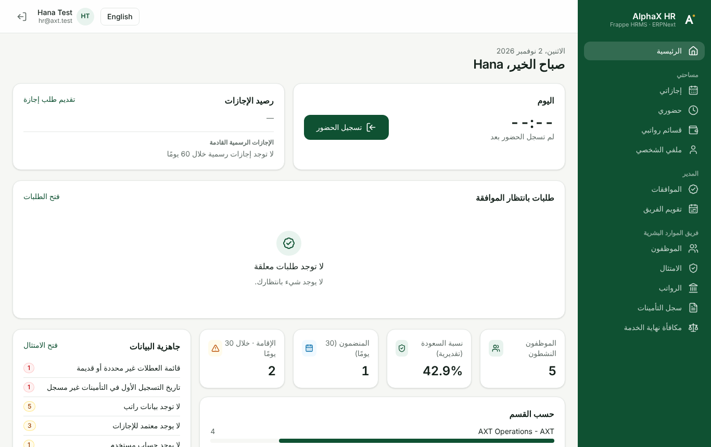
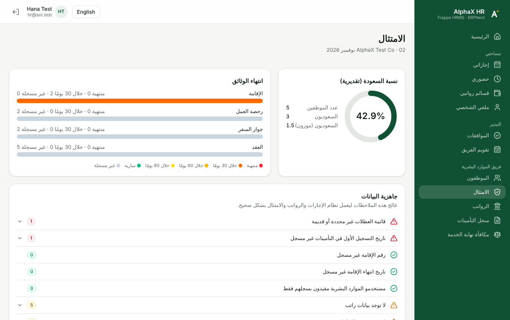
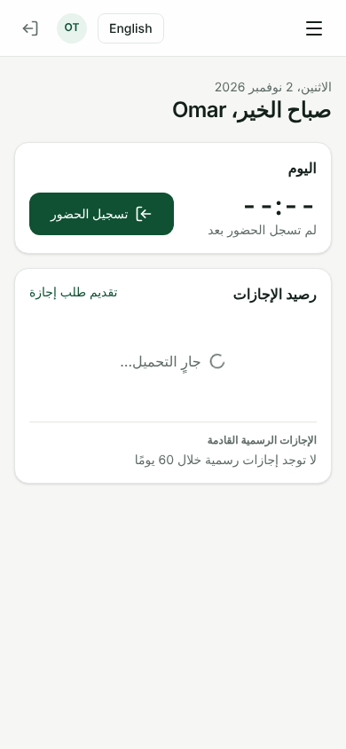

# AlphaX HR

A modern, bilingual (English / العربية) HR experience for Saudi companies, built in React on top of **Frappe HRMS + ERPNext**.

* **One system of record.** Every employee, leave, attendance, payroll and expense record lives in ERPNext/HRMS. AlphaX adds no parallel tables for them.
* **Own route, no Desk for users.** The app lives at `/alphax` (Frappe HRMS already uses `/hr/*` for its Roster).
* **No Desk for users.** Employees, managers and HR work entirely in `/alphax`. Desk stays for administrators.
* **Saudi rules built in.** GOSI (date-effective, Legacy vs New system), end-of-service (Articles 84/85/87/80), annual and sick leave, Iqama and document expiry, Nitaqat estimate. These replace the CentralHRMS features for new KSA customers.

```
React SPA (/alphax)  ──►  alphax_hr API (permission-checked)  ──►  Frappe HRMS + ERPNext (data)
                       └─ alphax_hr.saudi (pure rules engine, unit-tested)
```

| HR home | Compliance (Arabic) | Employee on phone (Arabic) |
|---|---|---|
|  |  |  |

## Modules (v0.6)

| Area | Who | What |
|---|---|---|
| Self-service | Every employee | Check in/out (with location), leave balance and requests, attendance month view, payslips with PDF, profile and contact updates, upcoming holidays |
| Approvals | Leave/expense approvers, HR | One inbox for Leave, Expense, Attendance, Shift and Compensatory requests; follows active Workflows; team leave calendar |
| HR core | HR User / HR Manager | People as list, table or organisation chart (from *Reports to*); department/status/nationality filters; quick view; Excel/CSV export; full profile with Print/PDF; missing mandatory fields highlighted with a popup; new employee as a step-by-step wizard (one ID field — the site's other ID fields are filled from it; Saudi/non-Saudi read from the ID) |
| Shifts & attendance | HR, every employee | Roster grid with per-employee week-offs (stored in the employee's own holiday list, so leave, attendance and payroll follow them) (week/2/4 weeks) with bulk shift assignment (overlaps refused per employee); monthly attendance register from check-ins, attendance, leave and holidays (present, absent, late with minutes, missing punch, overtime) with Excel export; overtime per Art. 107 (hourly wage + 50% of hourly basic); employees request attendance corrections and shift changes, approved in the AlphaX inbox |
| Leave balances & ledger | HR, employees, approvers | Balance per leave type for every employee (Excel export); per-employee ledger with running balance; Art. 117 sick-leave year (120 days from the first sick day, tiers full/75%/unpaid) — requests beyond it are refused |
| Activity trail | HR (and record readers) | Every change to HR records — field old → new, who, when, comments, workflow steps, attachments — per record (profile, any request) and as an HR-wide Activity log with filters |
| Setup & health | HR | One page for system health (scheduler, workers, AlphaX jobs, errors, email, Employee table space, holiday lists, approvers, salary mapping, leave setup, GOSI rates — each with a Fix link) and all AlphaX settings |
| Payroll | HR | Payroll runs, month slip summary, GOSI register, end-of-service calculator |
| Saudi leave engine | HR, every employee | Statutory leave rules checked on every request (maternity 84, paternity 3, marriage 5, bereavement 5/3, Iddah 130/15, exam, Hajj once after 2 years), sick-leave pay tiers 30/60/30 with certificate before approval, annual leave 21/30 days allocated per service year, escalation of leave requests left pending |
| Employee rules | HR | National ID / Iqama / border number checks (Saudi flag set from the ID), duplicate IDs, Saudi IBAN check, minimum age, probation end date |
| Compliance | HR | Nitaqat estimate, Iqama/work permit/passport/contract expiry, data-readiness checks (holiday lists, approvers, GOSI dates, Iqama data …) |

## Install

Requirements: Frappe/ERPNext/HRMS v15 (v16 targeted), Node 18+ only if you rebuild the frontend.

```bash
cd frappe-bench
bench get-app https://github.com/mskhanIND/alphax_hr
bench --site YOUR_SITE install-app alphax_hr
bench --site YOUR_SITE migrate
```

The built frontend is committed under `alphax_hr/public/frontend`, so no Node build is needed on servers. Open `https://YOUR_SITE/alphax`.

**Make /alphax the landing page.** Set *System Settings → Default App* (or a user's *Default App*) to **AlphaX HR**. Users then land on `/alphax` after login.

### First setup (5 minutes)

1. **AlphaX HR Settings:** default company; map salary components to *GOSI Basic*, *GOSI Housing* and *EOSB Wage*; optional Saudization target.
2. **GOSI Contribution Rate:** statutory rows are seeded (Legacy; New system 9% → 11% stepping each July 2025–2028; Non-Saudi 2% hazard). Edit them when GOSI publishes changes.
3. **Employees → Saudi Compliance tab:** *Saudi National*, *First GOSI Registration Date* (decides Legacy vs New; not the hire date), Iqama number/expiry for non-Saudis.
4. Open **Compliance** in `/alphax` and clear the data-readiness list.
5. Open **Leave setup** in `/alphax`:
   - **Create statutory leave types** adds any missing ones and links them to their rules. Existing leave types with matching names are linked automatically on install.
   - **Allow without allocation** on any statutory type flagged as needing an allocation (for example HRMS's own *Sick Leave*); the rule caps those leaves instead.
   - **Annual leave:** click **Set up Annual Leave** once (it links an existing *Annual Leave* type or creates it). Leave type names used by AlphaX are then fixed: they cannot be renamed or deleted.
   - Optional **Count seniority from** date: years for a company's senior entitlement are counted from that date (or the joining date, if later). The legal 30 days after 5 years from joining always applies.
   - Pick the **company policy**: *Saudi Labor Law* (21 days, 30 after 5 years) or *Fixed for all employees* (e.g. 30 days, as at IRSAA). An employee whose contract says otherwise gets *Annual Leave Days (contract)* on their profile. The legal minimum always applies.
   - Check the **allocation plan** (it shows what each number is based on), then **Create allocations** or tick *Allocate automatically every night*.

Settings for probation days, minimum age and IBAN checking are in *AlphaX HR Settings*.

### Coming from CentralHRMS

HR Manager → call `alphax_hr.api.compliance.import_legacy_fields` with `dry_run=1` to preview, then `dry_run=0`. It copies `custom_identity_number`, `custom_identity_valid_upto`, `custom_work_permit_expiry_date` and Saudi nationality into the AlphaX fields, only filling blanks.

## Security model

* No guest endpoints. Every API checks login, then server-side roles (never a role sent by the browser).
* Reads use permission-aware `frappe.get_list` / `check_permission`; writes go through `insert/save/submit`, so HRMS validations, Workflows and User Permissions remain authoritative.
* Employee self-service is always scoped to the employee linked to the signed-in user.
* Employee edits use optimistic locking (`modified`).

## Develop

```bash
# backend rules engine tests (no Frappe needed)
python -m unittest discover -s tests

# frontend
cd frontend
npm install
VITE_FRAPPE_URL=http://hr.test:8000 npm run dev   # proxies /api to your bench
npm run build                                      # outputs to alphax_hr/public/frontend
```

For local dev against a bench, sign in at the bench URL first and set `"ignore_csrf": 1` in that **development** site's `site_config.json`.

## Tests

| Suite | What | Run |
|---|---|---|
| Rules engine | 18 tests: GOSI Legacy/New/Non-Saudi rates by period, cap, EOSB Art. 84/85/87/80, annual and sick leave, Nitaqat, document buckets | `python -m unittest discover -s tests` |
| API integration | 21 tests on a real Frappe + ERPNext + HRMS site, as Guest, Employee, second Employee, Manager and HR: data isolation, role checks, approvals (incl. a Workflow action literally named "Submit"), stale-write rejection, GOSI/EOSB, compliance | `tests/integration/run_frappe_tests.py SITE` |
| Browser E2E | 17 checks driving `/alphax` in Chromium: apply → approve leave, attendance, people edit, compliance, GOSI, EOSB, Arabic RTL on a phone, no console errors | `node tests/e2e/smoke.mjs URL` |
| Frontend | Riyadh-time dates, and every UI string has an Arabic translation | `cd frontend && npx vitest run` |

All four run in GitHub Actions (`.github/workflows/ci.yml`).

## Layout

```
alphax_hr/
  api/            whitelisted API (session, ess, approvals, hr, payroll, compliance)
  saudi/          pure-Python Saudi rules (gosi, eosb, leave, nitaqat, documents)
  alphax_hr/      DocTypes (AlphaX HR Settings, GOSI Contribution Rate) + Employee custom fields
  www/alphax.*    serves the SPA at /alphax
  public/frontend built React app
frontend/         React 19 + TypeScript + Vite + TanStack Query + Tailwind
tests/            rules-engine tests and Frappe integration tests
```

Nitaqat figures are an internal estimate; Qiwa remains the official source.

License: MIT
